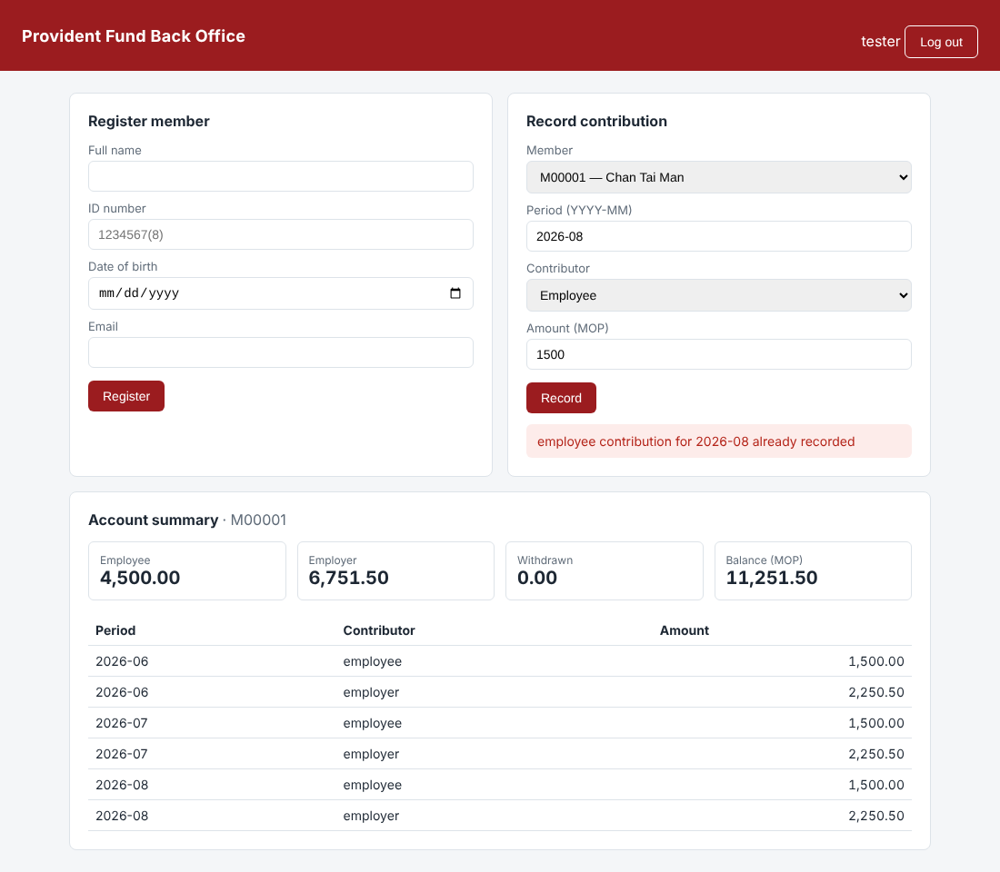

# Provident Fund QA Automation Portfolio


End-to-end test automation for a small provident-fund back-office system:
**API, UI, Postman, ML-model and load testing**, wired into a GitHub Actions pipeline.

The system under test (a FastAPI service with a web UI and an ML risk-scoring endpoint) is
included in the repo, so everything runs locally with one install — no external services.



| Suite | Tool | Tests | What it shows |
|---|---|---|---|
| API functional & contract | pytest · requests · jsonschema | 103 | Business rules, boundary values, negative paths, schema validation, security controls |
| Web UI | Playwright · Page Object Model | 14 | Critical journeys, validation messages, UI ↔ API consistency, XSS check |
| ML model | pytest (black-box via API) | 24 | Accuracy/precision/recall gate, golden cases, metamorphic tests, p95 latency |
| API regression | Postman · Newman | 18 requests / 35 assertions | Chained requests, variables, pre-request scripts, JSON-schema checks |
| Performance | Locust | — | Realistic mixed workload with an automatic SLA pass/fail gate |

---

## Quick start

Requires Python 3.11+ (3.13 used in CI) and, for the Postman suite, Node.js 18+.

```bash
git clone https://github.com/<alanleongmacau>/pension-qa-automation.git
cd pension-qa-automation
python -m venv .venv
source .venv/bin/activate          # Windows PowerShell: .venv\Scripts\Activate.ps1
pip install -r requirements.txt
playwright install chromium
```

Run everything (the test fixtures start and stop the app for you):

```bash
pytest                       # all 141 tests  → reports/test-report.html
pytest -m smoke              # 8 critical-path checks, ~10 s
pytest tests/api             # API only
pytest tests/ui --headed     # watch the browser
pytest tests/ml              # model quality gate → reports/model_metrics.json
pytest -m security           # auth, lockout, audit trail, XSS
```

Postman and Locust need the app running:

```bash
APP_ENV=test uvicorn app.main:app --port 8000       # Windows: $env:APP_ENV="test"; uvicorn app.main:app --port 8000

npx newman run postman/ProvidentFund.postman_collection.json -e postman/local.postman_environment.json

locust -f perf/locustfile.py --host http://127.0.0.1:8000 --headless -u 30 -r 10 -t 30s --html reports/perf.html
```

Open <http://127.0.0.1:8000> to use the UI (`tester` / `Passw0rd!`) or <http://127.0.0.1:8000/docs> for the OpenAPI docs.
To run the pytest suites against a deployed environment instead, set `SUT_URL`.

---

## Project layout

```
app/                     System under test
  main.py                  FastAPI service — business rules R1–R8 documented at the top
  risk_model.py            Gradient-boosted risk model with monotonic constraints
  static/index.html        Back-office web UI (data-testid hooks for automation)
tests/
  conftest.py              Starts the app, resets state before every test, API client & data factories
  helpers/                 ApiClient wrapper, test-data factory, JSON schemas
  data/                    Data-driven cases + held-out labelled set for the ML model
  api/                     Auth, members, contributions, withdrawals, end-to-end lifecycle
  ui/pages/                Page objects
  ui/                      Playwright tests
  ml/                      Model quality, golden, metamorphic, contract and latency tests
postman/                 Collection + environment (run with Newman)
perf/locustfile.py       Load test with SLA gate
docs/TEST_PLAN.md        Scope, techniques, requirements-traceability matrix, exit criteria
docs/BUG-001.md          Example defect report for a known, tracked bug
.github/workflows/ci.yml 4 parallel jobs: API+ML, UI, Newman, Load test
```

## Highlights

**Test design, not just test code.** Every business rule maps to tests in the
[traceability matrix](docs/TEST_PLAN.md#3-requirements-traceability). Boundary-value analysis
(age 18/65 ± 1 day, amount 0.01 / 100,000 / 100,000.01), equivalence partitioning and data-driven
cases from JSON.

**Independent, order-agnostic tests.** State is reset before each test and data comes from
factories, so any test can run alone, in any order, or in parallel.

**Testing an ML model without knowing the right answer.** Besides a held-out quality gate
(recall weighted highest — a missed suspicious transaction costs more than a false alarm), the
suite uses *metamorphic* tests: increasing the amount or transaction count must never lower the
risk score, and an older account must never raise it.

**Security checks a compliance team would ask for.** All 8 business endpoints reject missing or
forged tokens, logout revokes the token, 5 failed logins lock the account (per user), every login
and financial event is audited, passwords never reach the audit log, and stored text is escaped
in the UI.

**Bug lifecycle.** [BUG-001](docs/BUG-001.md) (amounts with > 2 decimals are accepted) is a real
defect in the app, documented with repro steps, impact and root cause, and pinned by an
`xfail(strict=True)` test that will turn the build red once the bug is fixed and the marker is
not removed.

**Tests that can fail.** Key tests were mutation-checked: e.g. removing the HTML escaping in
the UI makes the XSS test fail; setting an impossible SLA makes the load test exit with code 1.

**Hybrid UI tests.** Data is seeded through the API and the browser is used only for the behaviour
under test — faster and far less flaky than clicking through setup screens. Screenshots and
Playwright traces are kept for failed tests (`reports/playwright/`).

## Reports

| File | Produced by |
|---|---|
| `reports/test-report.html` | pytest-html, self-contained |
| `reports/junit.xml` | JUnit XML for CI dashboards |
| `reports/model_metrics.json` | Confusion matrix, metrics and misclassified samples |
| `reports/perf.html` | Locust charts and percentiles |
| `reports/playwright/` | Screenshots + traces of failed UI tests (`playwright show-trace <zip>`) |

## Author

Alan Leong — system testing & risk compliance, CISA.
All data in this repository is synthetic.
